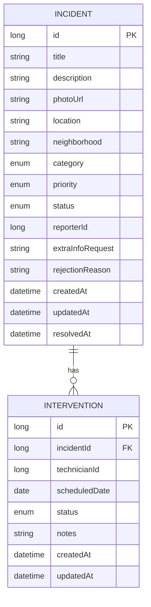

# Urban Incident service — data model

**Incident status:** REPORTED → PENDING_INFO / VALIDATED / REJECTED → IN_PROGRESS → RESOLVED → CLOSED

**Intervention status:** PENDING → IN_PROGRESS → COMPLETED (or CANCELLED)
